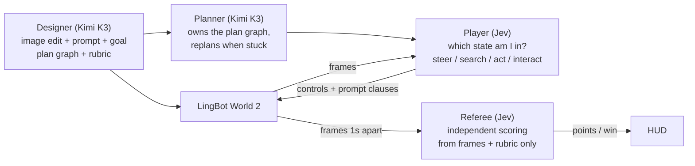

# Jev World

**A decision model plays games inside a world model.**

[LingBot World 2](https://www.reactor.inc) generates an interactive video world from one image and a prompt, in real time. [Jev](https://openrouter.ai/docs/guides/community/jev) — TypeSafe's decision model — watches that video and plays it. Kimi K3 designs the levels and plans, and a second Jev referees.

There's no game engine underneath. The rings, the key and the door exist only because the image and prompt put them there. Whether anything actually happened is up to an AI referee watching the frames.

## Four agents



| agent | model | sees | does |
| ----- | ----- | ---- | ---- |
| **Designer** (`app/api/design`) | Kimi K3 + nano-banana-pro (Replicate) | a theme (new world) or an image + idea | **New world:** writes a scene, renders the opening frame from scratch, then designs the level by looking at that frame. **From image:** designs the level and edits its objects into the image. Output: goal, world prompt, targets, **plan graph**, **rubric**. LingBot needs an opening image, so this step is required for any new world. |
| **Planner** (`app/api/plan`) | Kimi K3 (low effort) | current frame, plan, recent history | rewrites the plan graph when the player has been stuck in one state for 15s (or on 🧠 Replan) |
| **Player** (`app/api/jev`) | Jev | last two frames, plan | every tick: classifies the current **plan state** (`choice`), boxes every target (`box` + `noul` visibility), picks an action (`choice`). The state's mode decides control: **steer** = drive at the target's bounding box, **search** = turn toward where it was last seen, **act** = Jev's best allowed action, **interact** = fire a prompt event. |
| **Referee** (`app/api/referee`) | Jev, separate calls | two frames ~1s apart + rubric questions only | scores events ("passed through a ring"), with cooldowns, and decides the win. It never sees the plan or the player's reasoning, so the player can't grade its own homework. |

Everything is drawn onto one canvas: the live frame, the boxes, a steering line, the goal, score and timer, the plan with the current state lit up, and the player's and referee's probabilities. **● Record** captures that canvas, so the demo video is exactly what you see. The sidebar shows the plan as a live mermaid graph.

## Quick start

```bash
cp .env.example .env.local   # add your keys (see table below)
pnpm install
pnpm dev
```

Open http://localhost:3000, click **Connect**, pick a level, then **▶ Let Jev play**. With Jev off you can drive with WASD and ←/→ to scout a level yourself.

To make a new level, choose a starting image (or upload your own), optionally type an idea, then press **✦ Design a level**. Designed levels are saved in localStorage. The JSON is visible under **Level JSON**, so you can copy a good one into `lib/levels.ts`.

| env var              | default                     |                                     |
| -------------------- | --------------------------- | ----------------------------------- |
| `REACTOR_API_KEY`    | —                           | LingBot World 2 sessions            |
| `TYPESAFE_API_KEY`   | —                           | Jev, direct from TypeSafe (preferred) |
| `DESIGNER_BASE_URL` / `DESIGNER_API_KEY` | — | any OpenAI-compatible endpoint for the designer |
| `OPENROUTER_API_KEY` | —                           | fallback that can run both agents   |
| `JEV_MODEL`          | `jev-latest` (`typesafe/jev-1.14` on OpenRouter) | 1.14+ is required for `box` |
| `DESIGNER_MODEL`     | `kimi-k3-high` (`moonshotai/kimi-k3` on OpenRouter) | needs image input |
| `PLANNER_MODEL`      | `kimi-k3-low`               | faster replans                      |
| `REPLICATE_API_TOKEN`| —                           | optional: designer renders new scene images |

## Experiments

The point is to find what works. Ideas, roughly from easiest to hardest:

- **Navigation** — reach a landmark (*Buoy Run*). Tests `choice` steering plus `box` tracking.
- **Fetch & use** — key → door (*Key to the Neon Door*). Tests whether LingBot keeps an injected object stable, and whether Jev's `ready` gate stops early "interactions".
- **Ordering puzzles** — light three braziers in a specific order. Tests multi-stage state carried only in the prompt.
- **Driving** — keep a car on the road through turns. Tests closed-loop control at Jev's decision rate.
- **Adversarial designer** — the designer tries to write levels that are *possible but hard*, and the scores feed back into the next design.
- **Judge vs. world** — when a stage fails, was it Jev misjudging, or LingBot never rendering the outcome? Record both and label them.

Log findings below as you go.

| date | level | result | notes |
| ---- | ----- | ------ | ----- |
| 2026-11-12 | Buoy Run | ✅ complete, 26 decisions, ~45s | LingBot rendered the prompt-only red buoy (large, bright, one object). Jev steered to it, then drove onto the sand (done 0.95). Jev latency is 130–400ms per decision with 6 boxes + 4 checks. |
| 2026-11-12 | Key to the Neon Door | ❌ stuck on stage 1 | LingBot never rendered the prompt-only brass key (small object), so stage 1 can't complete. Jev's `interact` was correctly refused (ready 0.38–0.46). Before `MIN_HOLD_MS` existed, Jev's 0.2s decisions made the officer jitter and spin. |
| 2026-11-12 | Ring Run (4-agent version) | ✅ 5/5 rings in 72.7s, 60 player decisions | Prompt-only rings rendered, and LingBot grew them into a corridor of rings on stilts. Box steering + plan states worked (find → line up → punch through). The referee scored all 5 points; the first came early and may have been generous. Manual replan returned a revised graph in 7.2s. |
| 2026-11-12 | Neon Canyon Run (generated from the theme "race a hovercar through glowing neon gates in a desert canyon at night") | ✅ 5/5 gates in 142.1s, 7s to spare | First fully generated world: scene 7s → image 22s → level 44s. LingBot rejected the raw 1376×768 PNG, so opening images are now normalised to a 1248-wide JPEG. The world drifted hard (red rock → purple dunes) but kept spawning gates. The planner auto-replanned twice, ending at Scan → Chase arch → Close in → Punch through. Jev latency rose to ~2.2–2.5s per decision (from 130–400ms earlier). An earlier attempt lost its Reactor session mid-run (cause unknown); agents now auto-pause on disconnect. |
| 2026-11-12 | Ring Run (recorded, loose referee) | ⚠️ 5/5 in 35.1s, ~3 points false | Frame review: only ~2 points were real passes. LingBot's drifting world makes distant rings vanish between the referee's two frames, which looks like "passed through". |
| 2026-11-13 | Ring Run (recorded, evidence gate) | ✅ 5/5 in 99.6s | Rubric events can now require `evidence`: the player's own box must have shown the target big (≥35% of frame height) and centred within the previous 2.5s. Frame review: every point follows a close, centred ring; the clearest at ~81s, straight through. No points while rings were distant. Recordings now stream to `recordings/` in 1s chunks (an earlier take was lost when MediaRecorder never fired "stop"). |

Lessons so far: LingBot needs an opening image, so generated worlds need an image model; normalise opening images to a ~1248-wide JPEG. objects that only exist in the prompt need to be **big and visually loud**, or be in the starting image. Hold each control for at least ~1.2s, because Jev decides much faster than LingBot shows motion.

## Caveats

- Jev's image input and `box` are early ("Dreamer-ready") features and may change.
- The API routes are meant to run locally. Add auth before you deploy this anywhere public, because both routes spend your keys.
- Starter scene images come from the LingBot World 2 reference app.
